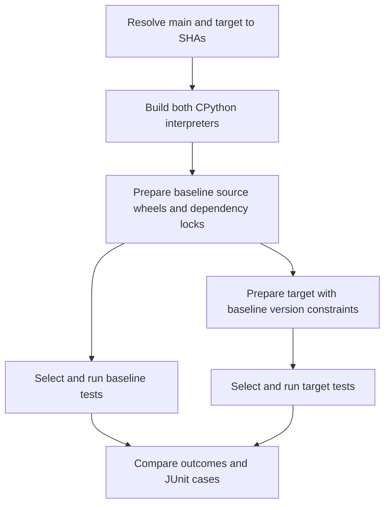

# Comparative runs in GitHub Actions

[downstream.yml](../.github/workflows/downstream.yml) compares a GitHub CPython
reference with the current `main` of `python/cpython`. It records the resolved
repository and full SHA for both sides before any interpreter build starts.
A PR URL selects its **head commit**, including a fork's repository. It does not
select GitHub's synthetic merge commit or the PR's merge base.

```sh
gh workflow run downstream.yml \
  -f ref='https://github.com/python/cpython/pull/12345' \
  -f platforms='aarch64-apple-darwin aarch64-unknown-linux-gnu i686-pc-windows-msvc x86_64-pc-windows-msvc x86_64-unknown-linux-gnu' \
  -f mode=release
```

| Input | Meaning |
| --- | --- |
| `ref` | Required branch, commit, GitHub PR/commit/tree URL, or `owner/repo:branch`. A bare ref is in `python/cpython`. |
| `platforms` | Required space-separated recorded Tier 1 target triples. |
| `mode` | `debug` (default), `release_assertions`, or `release`, optionally suffixed with `-freethreading`. |
| `projects` | Optional space-separated recipe names; blank selects the whole catalog. |
| `max_parallel` | Maximum concurrent package jobs in each platform/side matrix, default 8. |

For example, `-f ref=somebody/cpython:fix-encoding -f projects=packaging` selects a
fork branch and a small project set. `gh workflow run --ref` selects the *harness*
workflow branch; `-f ref=...` selects the CPython revision under test.
Public GitHub refs are resolved through the GitHub API. The workflow gives the
trusted planning step a read-only token; local planning can use `GITHUB_TOKEN`
when needed. Ref strings are data, never interpolated into executable shell code.

Local planning and report generation are also available:

```sh
uv run --locked python -m snake_pit plan --ref "$CPYTHON_REF" --platform "$TARGET_TRIPLE"
uv run --locked python -m snake_pit.comparison plan --ref "$CPYTHON_REF" \
  --platform "$TARGET_TRIPLE" --project packaging --output comparison-plan.json
uv run --locked python -m snake_pit.comparison report \
  --plan comparison-plan.json --artifacts downloaded-outcomes --output comparison
```

## Work scheduling and dependency builds

Each platform has a pair of interpreter builds and separate package preparation
and test jobs. Different platforms proceed independently. Reusable workflows and
matrices implement the fan-out; see [GitHub's workflow reuse documentation](https://docs.github.com/en/actions/how-tos/reuse-automations/reuse-workflows).



Preparation builds each selected recipe's source wheel and resolves its build
and runtime/test locks without running the test suite. The scheduler examines
those exact locked package names and versions, including transitive dependencies.
If `bar` has a known build failure and `foo` needs that version of `bar`, the
scheduler records `foo` as `blocked`, with `bar==version` as evidence, and creates
no installation/test job for `foo`.

Build availability is separate from a project's overall outcome. A built `bar`
remains usable by `foo` if `bar` has failing tests, collection errors, or even an
unresolvable optional test dependency. Test-dependency cycles such as pytest and
requests do not become build-scheduling cycles. Missing reports and infrastructure
failures are not treated as proven dependency build failures.

Successful prepared wheels are transferred as artifacts with hashes. Consumers
verify the interpreter, platform, mode, recipe revision, wheel digest, and package
metadata. A matching locked catalog dependency is installed from its freshly built
wheel rather than compiled again. A different locked version is neither blocked
nor replaced by a catalog provider's result.

These optimizations apply to the selected catalog providers. Non-catalog packages
still use each recipe's locked dependency installation. Initial source probes may
also compile build-backend dependencies before all provider wheels are available;
the scheduler prunes the later installation/test fan-out after the locks are known.
Selecting a project subset also narrows the providers whose builds are probed.

## Comparable dependency inputs

Baseline preparation records `pylock.tools.toml`, `pylock.backends.toml`,
`pylock.build.toml` and `pylock.toml`. Target preparation converts each available
baseline lock into exact version constraints for that phase. Tests retain their
own prepared versions and substitute verified wheels from their own interpreter's
builds. Wheel hashes can differ between main and target; package versions and
source recipe hashes are the comparison inputs.

This uses uv's documented [constraint and lock workflow](https://docs.astral.sh/uv/pip/compile/).
If the target cannot resolve the baseline versions, that failure remains visible;
constraints are not silently relaxed to make the target pass. A baseline failure
may prevent a later-phase lock from existing. The candidate can still progress
using the locks that are available, and the report preserves dependency differences.
A changed result with conflicting resolved versions is marked inconclusive.

When the ref resolves to exactly main's SHA, only one side is built and tested.
The report reuses those observations for both logical sides.

## Reading the comparison

The final `compare` job always runs after platform work, unless the workflow was
cancelled or planning failed. Its job summary emphasizes differences and collapses
unchanged results. The `comparison` artifact contains Markdown and JSON reports.

- **Regression:** main passes but target fails, a previously passing test fails,
  or a previously available package build becomes unavailable.
- **Improved:** a failing outcome or test becomes passing, or a build progresses.
- **Unchanged failure:** a failure already observed on main; this alone does not
  fail the comparative check.
- **Newly blocked:** a consumer cannot run because a required package build is
  unavailable. These rows retain blocker identities rather than pretending the
  consumer's own tests failed.
- **Newly observed failure:** a test fails without a recorded baseline pass, for
  example because the baseline stopped after ten failures. It is not labeled a
  demonstrated new test regression.
- **Coverage change:** previously passing cases become skipped or absent.
- **Inconclusive:** missing/truncated reports, infrastructure errors, timeouts,
  incompatible dependency versions, or incomplete interpreter preparation.

New regressions or newly blocked projects make the comparison job fail. Missing
or incomparable evidence also produces a non-success check. Existing package
failures are recorded as data rather than making every package job red. The JSON
retains the exact failing IDs, fixes, newly observed cases, and dependency changes.

JUnit suites are compared by class/name test ID. Repeated IDs (including separate
pytest call and teardown records) form one comparison group: every record must
pass for the group to pass, and all failure messages are retained in sorted order.
Collectors that reuse IDs therefore provide group-level evidence rather than
separate identities for each occurrence. The report only calls an
individual failure new when that test actually passed on main. Non-JUnit adapters
currently compare the overall phase/outcome; their detailed native runner output
remains in logs. A difference is an investigation lead, not proof that CPython is
at fault. Rerun flaky cases and minimize failures before attributing them.

## Builds, recipes and artifacts

All five recorded Tier 1 targets are available. The workflow uses `ubuntu-26.04`,
`ubuntu-26.04-arm`, `macos-26` and `windows-2025`. Windows x86 uses a 32-bit build and
matching tools. CPython's own CI excludes free-threaded Windows x86, so the planner
rejects that combination. The repository's `actionlint.yaml` supplies the newer
Ubuntu labels missing from actionlint 1.7.12's embedded runner list.

Interpreter builds use the requested revision's POSIX dependency script/Brewfile
or Windows `PCbuild/build.bat`. POSIX runs `make install`; Windows uses
`PC/layout/main.py` to retain development headers, import libraries and standard
library tests. Archives restore at the original absolute path for sysconfig.
`release_assertions` uses release optimization with assertions enabled; on Windows
it removes the MSBuild NDEBUG definition without switching to the debug CRT.

[data/recipes.toml](../data/recipes.toml) pins package versions, source URLs/hashes,
upstream test commits, test selections and native dependencies. Test jobs verify
source hashes and Git test-source identities. NumPy, pandas and greenlet use
installed test paths; lxml uses its native suite factories; Django uses its named
SQLite subset. Empty collection fails, and pytest stops after ten failures.
`import_mode`, `pytest_args` and `test_env` allow explicit upstream runner settings.
`test_env` takes effect after building and checking the package import. Pytest's
recipe reports warnings normally and clears forced faulthandler startup because
its own suite tests both enabled and disabled states.

Artifact names include side, platform, mode and project as appropriate:

| Prefix | Contents |
| --- | --- |
| `comparison-plan` | Resolved refs, selected projects/platforms and recipe hash. |
| `interpreter-*` | One interpreter build outcome. |
| `cpython-*` | Installed interpreter build, headers, provenance and pythoninfo. |
| `build-report-*` | Package source-build outcome and generated locks. |
| `prepared-*` | Source-built wheel, digest and locks for verified reuse. |
| `outcome-*` | Test/JUnit outcomes, or explicit blocked/preparation outcomes. |
| `logs-*` | Detailed per-phase logs, locks, selected tests and wheel hashes. |
| `comparison` | The final JSON and Markdown difference report. |

Hosted workers are disposable native jobs. Credentials are not persisted in
checkouts, and package subprocesses receive a restricted environment. These jobs
still resolve/download dependencies and do not enforce offline network isolation.
PEP 751 locks cover Python artifacts, not Cargo or native OS libraries. Runtime
locks do not yet capture every dynamic build hook's complete dependency closure.
See [the fuller qualification design](design.md) for those remaining boundaries.
