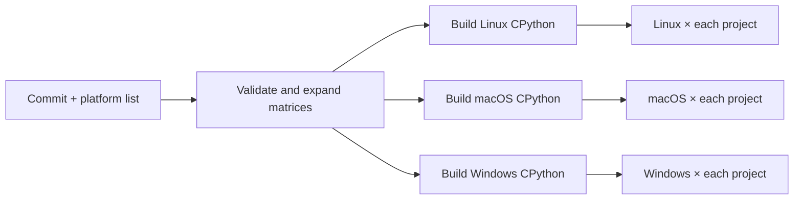

# Running builds and project tests in GitHub Actions

Run **CPython downstream tests** from the Actions tab, supplying:

- `commit`: the full lowercase, 40-character CPython Git SHA.
- `platforms`: a space-separated list of Tier 1 target triples from the README.
- `mode`: `debug` (default), `release_assertions`, or `release`, each optionally
  suffixed with `-freethreading` to disable the GIL.
- `max_parallel`: concurrent project jobs per platform (default 8).

For example, once this repository is pushed to GitHub:

```sh
gh workflow run downstream.yml \
  -f commit="$CPYTHON_COMMIT" \
  -f platforms='x86_64-unknown-linux-gnu aarch64-apple-darwin x86_64-pc-windows-msvc' \
  -f mode=debug \
  -f max_parallel=8
```

The workflow validates inputs before building anything. Each platform calls the
reusable `platform.yml` workflow, which has its own build followed by its project
matrix. A fast platform can start its project tests while other platforms are
still building. All five platforms produce five builds and 140 project jobs;
uvloop's two Windows combinations report `not-applicable`. Each recipe produces
one project job; transitive dependencies do not create additional jobs.



Both platform and project matrices use `fail-fast: false`. A failed interpreter
build blocks that platform's project matrix; it does not cancel other platforms.
A package failure does not cancel its siblings. Job timeouts provide an outer
bound; individual subprocesses also have stage timeouts and bounded logs.

## Interpreter builds

The build commands follow CPython's
[Ubuntu](https://github.com/python/cpython/blob/main/.github/workflows/reusable-ubuntu.yml),
[macOS](https://github.com/python/cpython/blob/main/.github/workflows/reusable-macos.yml), and
[Windows](https://github.com/python/cpython/blob/main/.github/workflows/reusable-windows.yml)
CI procedures. Dependency scripts and Brewfiles come from the **requested commit**.
Linux uses GCC, `configure`, and `make`; macOS uses the Brewfile, OpenSSL formula,
`configure`, and GNU make; Windows uses `PCbuild/build.bat -e -v` with `Win32` or
`x64`. Debug and free-threaded switches are explicit. Like current CPython CI,
free-threaded Windows x86 is rejected. Debug builds also enable safety configure
flags when the requested revision supports them.

| Base mode | Build configuration |
| --- | --- |
| `debug` (default) | Debug build with assertions (`--with-pydebug` or Windows `-d`) |
| `release_assertions` | Release build with C assertions enabled, retaining the release ABI |
| `release` | Release build with C assertions disabled |

Append `-freethreading` to any base mode for a free-threaded build, for example
`debug-freethreading`. POSIX release builds explicitly disable `Py_DEBUG` and
select [`--with-assertions` or `--without-assertions`](https://docs.python.org/3.14/using/configure.html#cmdoption-with-assertions).
Windows release builds use `-c Release`; `release_assertions` overrides MSBuild's
`_DebugPreprocessorDefinition` to remove `NDEBUG` while retaining release
optimization and the release CRT. The build rejects an unrecognized upstream
property definition rather than silently disabling assertions.

These builds adapt the upstream procedures; they do not run all of CPython's
own CI checks, PGO/BOLT variants, or compiler-warning comparisons. Linux currently
uses the runner distribution's OpenSSL rather than upstream CI's separately built
OpenSSL. `test.pythoninfo` records the resulting configuration. Runner labels are
explicit, but hosted image patch levels and OS package repositories can change;
their versions are recorded rather than claimed to be hermetically pinned.

POSIX builds run `make install` into `cpython/install` so extension builders such
as Meson can discover installed headers and sysconfig paths. Windows uses the
`PC/layout/main.py` with development headers, import libraries, and test helpers.
Windows project jobs initialize Visual Studio for the target architecture before
building extensions. Recipes can list Windows native dependencies in `windows`;
they are built with vcpkg in a job-local static-library layout
using the target build's dynamic CRT and debug/release configuration. This supplies Pillow's JPEG and zlib dependencies without
requiring extra runtime DLL search paths.

Each platform uploads `cpython-<target>-<mode>` containing the tarred build tree,
`build.json`, and `pythoninfo.txt`. The archive preserves executable bits, headers,
standard library/test helpers, generated configuration, and Windows DLLs. Project
jobs restore it at the original workspace path so sysconfig's build paths remain
usable, and verify the requested commit/platform/mode, archive hash, and interpreter
hash before using it. There is no cross-commit interpreter cache or fallback to
the control interpreter.

## Project jobs

[data/recipes.toml](../data/recipes.toml) specifies test selection, runner adapter,
version, source URL/hash, repository, release tag/commit, and additional test/native
dependencies for every selected project.
Recipes are initial qualification attempts, not certified compatibility claims.
Most use release-tagged upstream tests; the resolved commit is checked against the
recipe pin. A recipe can instead use tests included in the hash-verified sdist.
NumPy, pandas and greenlet use tests from the installed package, collected with
pytest's default import mode on their installed paths. This also supports test
directories without `__init__.py`. lxml uses its native `test.py --no-src` runner
so its `test_suite()` factories and doctests run correctly, while imports use
the installed extensions and pinned upstream test helpers. Django runs a
named SQLite subset through its own runner. Other recipes use pytest with separate
collection and execution phases, and JUnit output. Empty collection is a failure.
Pytest execution stops after ten failures so incompatible suites produce useful
diagnostics without running thousands of already-blocked cases. Upstream suites
run from their checkout with the current directory excluded from Python's default
import path; recipes can select `import_mode = "prepend"` when their test helpers
require it. `pytest_args` adds recipe-specific options, such as enabling JUnit
output when an upstream configuration disables its plugin.

The job reads the selected version and sdist digest from [data/recipes.toml](../data/recipes.toml),
downloads that exact sdist and verifies its digest, creates a
venv using the restored target interpreter, adds its executable directory to
`PATH` for build/test tools, seeds setuptools and wheel from
`pylock.tools.toml`, installs build backends from `pylock.backends.toml`, then
locks declared build requirements to
`pylock.build.toml`, and installs that build environment. It builds the package's
wheel from source with implicit build isolation disabled. It then locks that exact
local wheel plus runtime/test dependencies and the retained build tools into
`pylock.toml` and installs from it. Recipes may add `build_dependencies` for native
transitive dependencies that must build without implicit isolation.
Runtime and test dependencies are resolved for the target interpreter.
The build wheel is retained alongside the lock. Rust projects with a root
`Cargo.lock` have a locked fetch phase followed by offline Cargo builds.

Build and test dependency declarations, dynamic PEP 517 requirements, nested Cargo
workspaces, native transitive dependencies, optional test fixtures, and upstream
test layouts may need recipe changes. Common build backends are installed from a seed lock before source-only build
dependencies are compiled. Missing build requirements produce a failed
stage rather than an implicit unpinned build environment. No automatic ABI3
workaround or pure Python fallback replaces a failed native build. The root
project is always built from source; compatible wheels are permitted for dependencies.

Every completed project invocation uploads `results-<target>-<mode>-<project>` with
`result.json`, stage logs, generated lockfiles, the built wheel when available,
source/recipe/interpreter hashes, the exact selected tests, and JUnit results where
supported. Review collection errors, skips and xfails when qualifying a recipe;
an exit code alone does not certify meaningful coverage.

Build, runtime and test dependencies are freshly resolved in each qualification
run. The resulting locks make that run's chosen Python artifacts auditable, but
separate dispatches can choose different dependency versions. For regression
comparisons, retain/reuse those locks; baseline comparison and replay orchestration
remain future work.

## Execution environment and checks

Downstream builds, metadata hooks and tests run only on manually dispatched,
fresh GitHub-hosted VMs. Checkouts do not persist Git credentials, permissions are
read-only, application secrets are not passed, candidate subprocess environments
are restricted, and caches are not shared between jobs. GitHub-hosted VMs allow
outbound networking; these workflows do not implement the design's stronger
offline/egress-denied execution boundary or OS-level resource quotas. Locking
does not sandbox third-party code. Use stronger isolated infrastructure when that
threat model is required; the prepared-worker interface remains available.

The separate **Code checks** workflow runs strict mypy and the repository's tests
under Python 3.14 on Linux, macOS and Windows for pushes and pull requests. It does
not execute third-party project suites on pull requests. To verify locally:

```sh
uv sync --locked
uv run --locked mypy
uv run --locked python -m unittest discover -s tests -v
uv run --locked python -m snake_pit.actions matrix \
  --commit "$CPYTHON_COMMIT" --platform "$TARGET_TRIPLE"
```

Native build and downstream qualification results depend on the chosen commit,
platform and recipe versions. Inspect uploaded results for each pair; workflow
syntax and local harness tests alone do not establish downstream compatibility.
